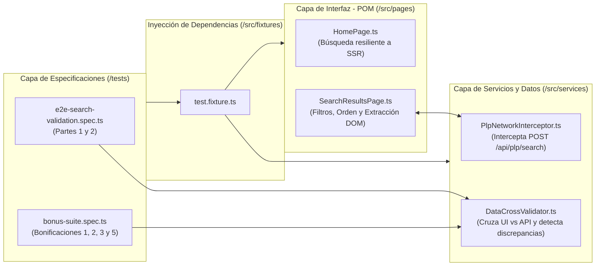

# Liverpool E2E & Network Cross-Validation Automation Framework

[](https://github.com/RubenAl7/Liverpool-E2E-Network-Cross-Validation-Automation-Framework/actions/workflows/test.yml)
[](https://playwright.dev/)
[](https://www.typescriptlang.org/)

Marco de automatización de pruebas **End-to-End (E2E)** y **validación multicapa de servicios (UI vs. BFF API)** diseñado para el flujo de búsqueda, filtrado y ordenamiento de comercio electrónico en [Liverpool México (`https://www.liverpool.com.mx/`)](https://www.liverpool.com.mx/).

---

## Arquitectura del Marco (Comprensible en < 10 minutos)

El proyecto aplica separación estricta de responsabilidades combinando **Page Object Model (POM)**, **Playwright Custom Fixtures** y una **Capa de Interceptación y Validación Cruzada de Servicios**:



### Estructura de Directorios

```text
├── .github/workflows/
│   └── test.yml                        # Parte 3: Pipeline de CI en GitHub Actions + artefacto HTML
├── src/
│   ├── config/
│   │   ├── selectors.ts                # Catálogo centralizado de selectores DOM de Liverpool
│   │   └── test-data.ts                # Configuración centralizada, SLAs y escenarios Data-Driven
│   ├── fixtures/
│   │   └── test.fixture.ts             # Fixtures tipados que inyectan Page Objects e Interceptor
│   ├── pages/
│   │   ├── HomePage.ts                 # Navegación inicial y búsqueda con guarda de hidratación SSR
│   │   └── SearchResultsPage.ts        # Filtrado por color, ordenamiento y extracción del DOM
│   ├── services/
│   │   ├── PlpNetworkInterceptor.ts    # Interceptación determinista de respuestas BFF (/api/plp/search + SSR)
│   │   └── DataCrossValidator.ts       # Motor de validación cruzada UI vs API y reporte de discrepancias
│   ├── types/
│   │   └── product.types.ts            # Contratos TypeScript para productos UI, payload API y reportes
│   └── utils/
│       └── price-parser.ts             # Parser especializado de precios DOM (centavos en superíndice / .invisible)
├── tests/
│   ├── unit-framework.spec.ts          # Pruebas unitarias rápidas del framework (parser, normalizador y validador)
│   ├── e2e-search-validation.spec.ts   # Partes 1 y 2 (Requerido): Flujo E2E + Validación cruzada de red
│   └── bonus-suite.spec.ts             # Bonificaciones: Rendimiento, Accesibilidad (axe-core), Visual y Data-Driven
├── playwright.config.ts                # Configuración global (headless por defecto, screenshots on failure, paralelo)
├── TEST_STRATEGY.md                    # Parte 4: Documento de estrategia de pruebas y decisiones de arquitectura
└── README.md
```

---

## Requisitos Previos

* **Node.js**: `v20.x` o superior.
* **npm**: `v10.x` o superior.

---

## Instalación Local

1. Clonar el repositorio e instalar las dependencias:

```bash
git clone https://github.com/RubenAl7/Liverpool-E2E-Network-Cross-Validation-Automation-Framework.git
cd Liverpool-E2E-Network-Cross-Validation-Automation-Framework
npm ci
```

2. Instalar los navegadores de Playwright:

```bash
npx playwright install --with-deps chromium firefox webkit
```

> **Nota para entornos corporativos Windows/macOS**: `playwright.config.ts` detecta automáticamente si el binario empaquetado de Chromium está instalado; si un firewall corporativo bloquea la descarga de *Chrome for Testing*, el framework utiliza de forma transparente el canal `chrome` del sistema operativo.

---

## Ejecución de Pruebas

### 1. Modo Sin Interfaz Gráfica — *Headless* (Predeterminado)

Ejecuta toda la suite (Pruebas Unitarias, Partes 1 y 2, y Bonificaciones) en modo *headless*:

```bash
npm test
```

Para ejecutar únicamente el flujo principal requerido (**Parte 1 y Parte 2**):

```bash
npm run test:e2e
```

Para ejecutar las **pruebas unitarias del propio framework** (parser de precios, normalizador de registros de API y motor de validación cruzada, sin requerir conexión a internet):

```bash
npm run test:unit
```

### 2. Modo Con Interfaz Gráfica — *Headed*

Para visualizar el navegador en tiempo real durante la ejecución:

```bash
npm run test:headed
```

O únicamente para la prueba principal E2E en modo *headed*:

```bash
npm run test:e2e:headed
```

También puedes pasar directamente la bandera nativa de Playwright o la variable de entorno `HEADED=true` / `HEADED=1`:

```bash
npx playwright test --headed
```

### 3. Variables de Entorno Soportadas

| Variable | Descripción | Valor por Defecto |
| :--- | :--- | :--- |
| `SEARCH_TERM` | Término de búsqueda parametrizado | `playstation 5` |
| `COLOR_FILTER` / `FILTER_COLOR` | Faceta de color a aplicar | `Blanco` |
| `PERF_SLA_MS` / `MAX_LOAD_MS` | Presupuesto máximo de carga de la PLP (ms) | `12000` |
| `HEADED` | `true` o `1` para abrir navegador con interfaz gráfica | `false` |

### 4. Puntos de Bonificación Incluidos

| Bonificación | Descripción | Comando de Ejecución |
| :--- | :--- | :--- |
| **1. Regresión Visual** | Comparación de snapshot (`toHaveScreenshot`) del control estructural de ordenamiento en la PLP. | `npm run test:bonus` (o actualizar base con `npm run test:update-snapshots`) |
| **2. Accesibilidad (`axe-core`)** | Auditoría WCAG automatizada sobre la página de resultados adjuntando hallazgos al reporte HTML. | `npm run test:bonus` |
| **3. Rendimiento (SLA)** | Verifica que la búsqueda y renderizado de resultados complete en menos de `N` segundos (`PERF_SLA_MS`, por defecto `12000` ms) y registra métricas *Navigation Timing* (TTFB, DOMInteractive). | `npm run test:bonus` |
| **4. Ejecución en Paralelo Multi-Navegador** | Configurado con `fullyParallel: true` y proyectos para `chromium`, `firefox` y `webkit`. | `npm run test:parallel-browsers` |
| **5. Pruebas Basadas en Datos (*Data-Driven*)** | Parametrización dinámica para `"playstation 5"`, `"Xbox Series X"` y `"Nintendo Switch"` sin modificar código. | `npm run test:bonus` o `SEARCH_TERM="Nintendo Switch" npm run test:e2e` |

### 5. Visualización del Informe HTML y Evidencias (Parte 3)

Al finalizar cualquier ejecución, se genera automáticamente un reporte HTML en `playwright-report/` que incluye:
* Capturas de pantalla automáticas en caso de fallo (`screenshot: 'only-on-failure'`).
* Trazas interactivas y video en caso de fallo (`trace: 'retain-on-failure'`).
* Archivos JSON adjuntos con el resultado de la validación cruzada (`ui-vs-api-cross-validation-report.json`, `discrepancies-ui-vs-api.json`) y auditoría `axe-core` (`axe-accessibility-violations.json`).

Para abrir el reporte interactivo localmente:

```bash
npm run report
```

---

## Integración Continua (GitHub Actions)

El flujo de trabajo ubicado en [`.github/workflows/test.yml`](.github/workflows/test.yml) se ejecuta automáticamente en cada `push` y `pull_request` hacia `main`/`master` (y manualmente mediante `workflow_dispatch`):

1. Instala dependencias con `npm ci`, verifica el tipado con `npm run typecheck` e instala los navegadores de Playwright.
2. Ejecuta las pruebas en modo *headless*.
3. Publica siempre (`if: always()`) el informe HTML completo como artefacto descargable (`playwright-html-report`).

* **Ejecuciones exitosas en GitHub Actions (Workflow Runs)**: [https://github.com/RubenAl7/Liverpool-E2E-Network-Cross-Validation-Automation-Framework/actions/workflows/test.yml](https://github.com/RubenAl7/Liverpool-E2E-Network-Cross-Validation-Automation-Framework/actions/workflows/test.yml)
